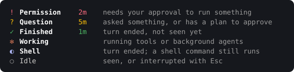

# claude-sessions

**See at a glance which Claude Code session is waiting for you.**

`cst` runs several Claude Code sessions side by side in tmux, one window per session, with a
sidebar that lists them all and a landing page to start or resume any of them.

<p align="center">
  
</p>

## What it adds to Claude Code

| Feature | Claude Code | `cst` |
|---|:---:|:---:|
| Sessions side by side, one window each | — | ✓ |
| Status and waiting time of every session | — | ✓ |
| Most urgent session first, Alt+↑ / Alt+↓ | — | ✓ |
| Resume a session from any folder | per folder | ✓ |
| Search sessions by title or prompt, any folder *(new)* | — | ✓ |
| Start in a new or unlisted folder from the list *(new)* | — | ✓ |
| Spend today and this week, 5-hour and 7-day quota | partial | ✓ |
| Statistics by day, folder and model | — | ✓ |

## Statuses

<p></p>

## Landing page

`cst` opens on the landing page: your folders and their recent sessions, a search over every
session, and the day's and week's statistics.

<p align="center">
  
</p>

## Keys

| Keys | Does |
|---|---|
| Alt+↑ / Alt+↓ | Previous / next session, most urgent first |
| Alt+n | New-session panel: pick a folder, resume a session, or search |
| Alt+c | Close the current session, after a confirmation |
| Ctrl+n / Ctrl+o | New-session panel and landing page: show or hide New folder / Open another folder |
| / | Landing page: search |
| n / o | Landing page: show or hide New folder / Open another folder |
| q | Landing page: end `cst` and every session in it |

## Get started

Needs Linux (x86_64 or arm64), tmux 3.2 or newer and Claude Code.

```sh
curl -fsSL https://raw.githubusercontent.com/emanuel36/claude-sessions/main/install.sh | sh
```

<details>
<summary>What the install script does</summary>

- Downloads the latest [release](https://github.com/emanuel36/claude-sessions/releases) and
  checks its SHA-256.
- Installs `cst` in `~/.local/bin`.
- Registers a hook and the status line in Claude Code's `settings.json`, after a backup.
- Removes the Python version (1.x) if it is installed.

</details>

- **Open:** `cst`, or `cst --ghostty` for a new Ghostty window.
- **Update:** `cst update`. Your sessions keep running.
- **Uninstall:** `cst uninstall` restores your settings; then delete `~/.local/bin/cst`.

## Where things live

```
~/.local/bin/cst                 the program
~/.claude/settings.json          hook and status line (backup beside it)
~/.local/state/cst/
├── history.json                 prompts read from Claude Code's history
├── titles.json                  session titles
├── spend.json                   tokens by model read from the week's transcripts
├── statusline.json              cost and quota last reported
├── journal/                     the day's activity, for the statistics
├── tmux.conf                    the tmux configuration in use
└── errors.log                   failures
```

## How the repository is organised

```
claude-sessions/
├── src/
│   ├── core/      session status, records, cost history, file locations
│   ├── claude/    Claude Code side: hook, status line, install, history
│   ├── term/      tmux side: launcher, configuration, window layout
│   └── ui/        landing page, sidebar, new-session panel, search
├── assets/        tmux configuration
├── tests/         integration tests and screen goldens
└── install.sh     installer
```

## Troubleshooting

| Symptom | Cause |
|---|---|
| A session never changes colour | Not in a `cst` window, or hooks missing: run `cst update` |
| Cost is empty | The status line has not reported yet, or another tool replaced it |
| Anything else | See `~/.local/state/cst/errors.log` |

## License

[Apache License 2.0](https://github.com/emanuel36/claude-sessions/blob/main/LICENSE)
