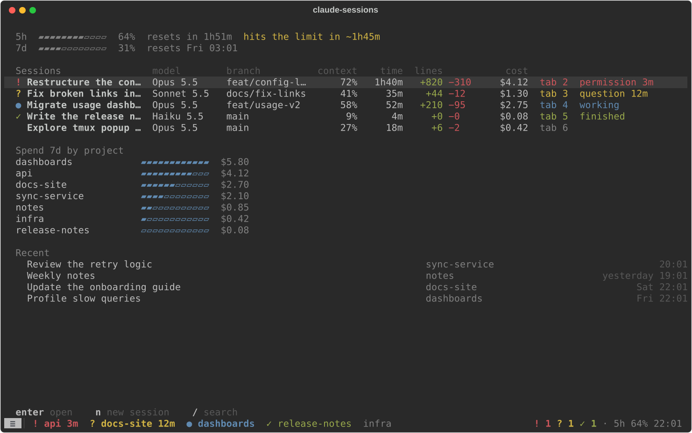

# claude-sessions

Run several Claude Code sessions in tmux and see at a glance which one needs you. Each tab is
one session, coloured by its status; tab 1 is a panel with quota, sessions and spend.

<p align="center">
  
</p>

- **Status on every tab:** permission, question, finished, working, shell or idle, with how
  long it has waited for you or on a command.
- **One key to what needs you:** Alt+n jumps to the next waiting session.
- **Info in the tab bar:** the current tab's mode, branch, cost and context, then the tabs waiting or finished and the 5-hour quota, before the clock.
- **Keeps your setup:** `cs install` adds hooks and keeps your own status line; `cs uninstall`
  puts everything back.

## Statuses

| Status | Tab | Meaning |
|---|---|---|
| Permission | red `!` | Claude needs your approval to run something |
| Question | amber `?` | Claude asked you something, or has a plan to approve |
| Finished | green `✓` | The turn ended and you have not looked yet |
| Working | blue `●`, blinking | Running tools, or waiting on background agents |
| Shell | cyan `⧗` | The turn ended and a shell command, such as a build, still runs in the background |
| Idle | grey | Seen, or interrupted with Esc |

## Keys

Every shortcut is Alt plus one key, from any tab.

| Keys | Does |
|---|---|
| Alt+1 | The panel (tab 1) |
| Alt+2 … Alt+9 | The tab with that number |
| Alt+0 | Back to the tab you were on before |
| Alt+← / Alt+→ | Previous / next tab |
| Alt+n | The next session that needs you |
| Alt+c | New session: pick a folder (with its git state and sessions beside it), then start a new session or resume an earlier one |
| Alt+g | Commit history of the tab's project in a split on the right; again to close |
| Alt+r | Rename the tab |

## The panel

- **Quota:** your 5-hour and 7-day usage, when each resets, and when the 5-hour limit fills at
  the current pace.
- **Sessions:** one row per open session with its state, model, branch, context use, time
  open, lines changed and cost. Enter goes to its tab.
- **Spend:** what each project cost over the last 7 days.
- **Recent:** earlier sessions to resume with Enter; `n` starts a new one and `/` searches.

## Get started

On Linux with tmux 3.3 or newer, fzf, uv and Claude Code, the
[install script](https://github.com/emanuel36/claude-sessions/blob/main/install.sh) sets
everything up and registers it with Claude Code. Then open it with `cst`. tig is optional, for
Alt+g.

- **What it changes:** a hook on 11 Claude Code events and the status line setting in
  `settings.json`. Your own hooks and status line keep working, and a backup of your settings
  is kept beside them.
- **Ghostty:** `cst --ghostty` opens a window that leaves the Alt keys to tmux.
- **Update:** run the install script again. A running tmux server keeps its old configuration
  until you quit it and open `cst` again.
- **Uninstall:** `cs uninstall` restores your settings, then remove the package with uv.

## Troubleshooting

| Symptom | Cause |
|---|---|
| A tab never changes colour | The session is not in a `cst` tab, or the hooks are missing: run `cs install` and check `hook-errors.log` in the runtime folder |
| Model, cost or context cells are empty | The status line has not reported yet, or another tool replaced it: run `cs install` again |
| Quota is missing | Claude Code reports usage limits only to subscribers, after the first response |
| The Alt+c popup closes at once | fzf is not on the tmux server's `PATH` |

## How it is organised

```
claude-sessions/
├── src/claude_sessions/
│   ├── cli.py       the cs command
│   ├── core/        session status, live records, history of costs
│   ├── claude/      Claude Code side: the hook, the status line, its files, cs install
│   ├── term/        tmux side: tab colours, the cst launcher, tmux config, new-session picker
│   └── panel/       tab 1: data/ loads what it shows, view/ draws it, app.py runs it
├── install.sh       the one-command install
├── docs/            screenshots
├── scripts/         screenshots.py, which redraws the screenshots
└── tests/
```

## License

[Apache License 2.0](https://github.com/emanuel36/claude-sessions/blob/main/LICENSE)
