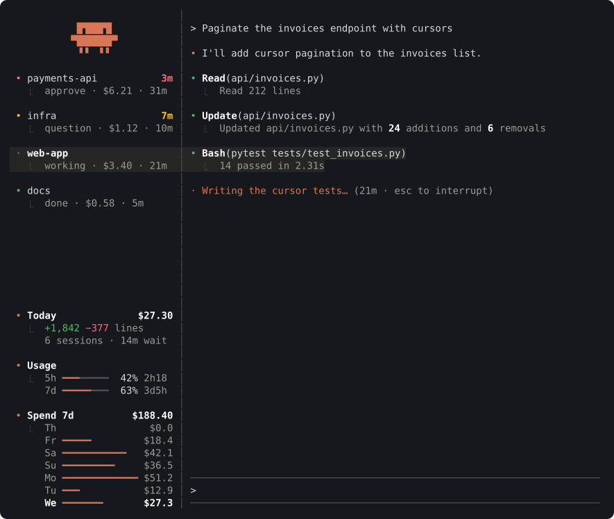
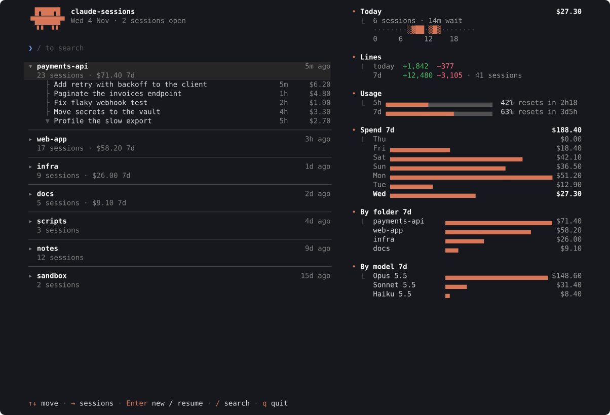

# claude-sessions

**See at a glance which Claude Code session is waiting for you.**

claude-sessions is a small tool, built on open-source software, for running several Claude Code
sessions side by side. Its goal is to cut development latency: the time a session sits idle
waiting for a person to approve a tool, answer a question or read a finished turn. It is one
program, `cst`, with nothing else to install.

<p align="center">
  
</p>

- **Status at a glance:** every session shows whether it needs approval, has a question, has
  finished, is working or is idle, and how long it has waited.
- **Most urgent first:** sessions that need you sit at the top of the sidebar; Alt+↑ / Alt+↓ go
  to them in that order.
- **Cost and quota in view:** today's spend, the 5-hour and 7-day quota and the week's spend sit
  under the sessions.
- **Keeps your setup:** your own hooks and status line keep working, and uninstalling puts
  everything back.
- **Quiet when out of sight:** a sidebar you are not looking at does no work.

## Built on

| Piece | Role |
|---|---|
| [tmux](https://github.com/tmux/tmux) | One window per session, with the sidebar on its left |
| [Claude Code hooks](https://docs.claude.com/en/docs/claude-code/hooks) and status line | Each session's status, cost and model |
| [ratatui](https://github.com/ratatui/ratatui) | The sidebar, the landing page and the new-session panel |

## The landing page

Where `cst` opens: the folders you ran Claude in, their recent sessions to resume, and the day's
and week's statistics.

<p align="center">
  
</p>

## Statuses

| Status | Colour | Meaning |
|---|---|---|
| Permission | red | Claude needs your approval to run something |
| Question | amber | Claude asked something, or has a plan to approve |
| Finished | green | The turn ended and you have not looked yet |
| Working | orange spinner | Running tools or background agents |
| Shell | lavender | The turn ended; a shell command still runs |
| Idle | grey | Seen, or interrupted with Esc |

## Keys

| Keys | Does |
|---|---|
| Alt+↑ / Alt+↓ | Previous / next session, most urgent first |
| Alt+n | New session, or resume one, from the folders you used |
| Alt+r | Rename the current session |
| Alt+c | Close the current session, after a confirmation |

On the landing page: ↑ ↓ move, → / ← show or hide a folder's sessions, Enter starts or resumes,
/ searches, q quits.

## Get started

Needs Linux (x86_64 or arm64), tmux 3.3 or newer and Claude Code. Install with one command:

```sh
curl -fsSL https://raw.githubusercontent.com/emanuel36/claude-sessions/main/install.sh | sh
```

The [install script](https://github.com/emanuel36/claude-sessions/blob/main/install.sh):

1. Checks that the system is Linux and that tmux is 3.3 or newer.
2. Downloads the latest [release](https://github.com/emanuel36/claude-sessions/releases) for
   your machine and checks its SHA-256.
3. Removes the Python version (1.x) if it is installed.
4. Installs `cst` in `~/.local/bin`.
5. Registers `cst` with Claude Code: a hook on 11 events and the status line in
   `settings.json`. Your own status line keeps running, and a backup of your settings is kept
   beside them.
6. Tells you if `~/.local/bin` is not on your PATH yet, and if a `cst` from before is still
   open.

Then open it with `cst`, or `cst --ghostty` for a new Ghostty window.

- **Update:** run `cst update`, then quit `cst` and open it again.
- **Uninstall:** run `cst uninstall`, which restores your settings, then delete
  `~/.local/bin/cst`.
- **Coming from 1.x:** the hooks and your own status line carry over; the cost history of the
  Python version is not read, so the day's and week's statistics start afresh.

## Troubleshooting

| Symptom | Cause |
|---|---|
| A session never changes colour | It is not in a `cst` window, or the hooks are missing: run `cst update` |
| Cost is empty | The status line has not reported yet, or another tool replaced it |
| Quota is missing | Claude Code reports it only to subscribers, after the first response |
| The sidebar is blank or out of date after an update | Open windows still run the old version: quit `cst` and open it again |
| Anything else | Failures are written to `~/.local/state/cst/errors.log` |

## How it is organised

| Folder | What it holds |
|---|---|
| [src/core](https://github.com/emanuel36/claude-sessions/tree/main/src/core) | Session status, live records, cost history, where files live |
| [src/claude](https://github.com/emanuel36/claude-sessions/tree/main/src/claude) | Claude Code side: hook, status line, install, prompt history, transcripts |
| [src/term](https://github.com/emanuel36/claude-sessions/tree/main/src/term) | tmux side: the `cst` launcher, its config and window layout |
| [src/ui](https://github.com/emanuel36/claude-sessions/tree/main/src/ui) | Landing page, sidebar, new-session panel, and what they watch |
| [src](https://github.com/emanuel36/claude-sessions/tree/main/src) | The `cst` command, self-update and capped child processes |
| [assets](https://github.com/emanuel36/claude-sessions/tree/main/assets) | The tmux configuration `cst` runs with |
| [tests](https://github.com/emanuel36/claude-sessions/tree/main/tests) | Integration tests and the screen goldens |
| [bench](https://github.com/emanuel36/claude-sessions/tree/main/bench) | The performance check |

## License

[Apache License 2.0](https://github.com/emanuel36/claude-sessions/blob/main/LICENSE)
