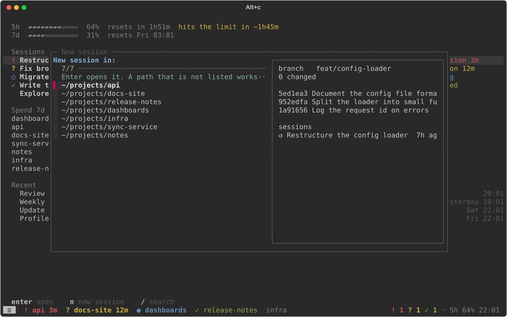
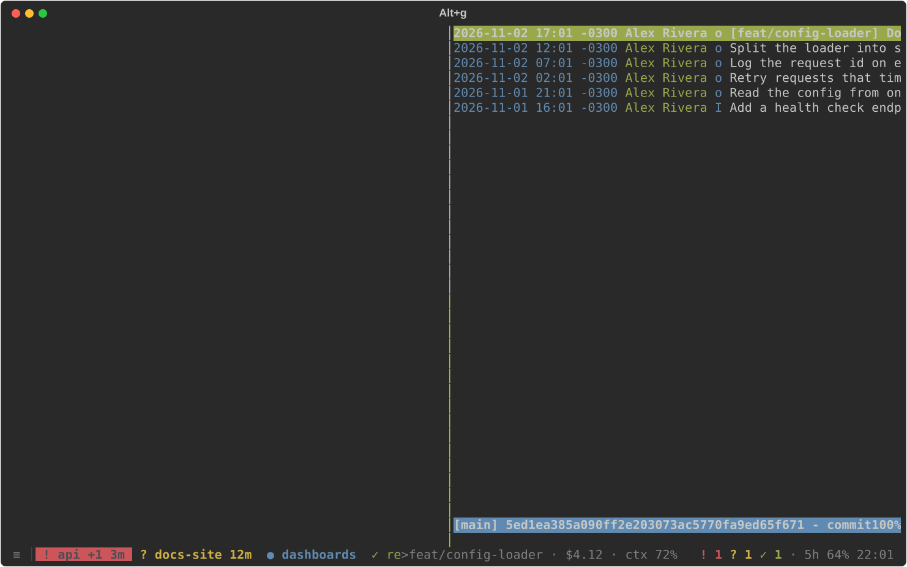
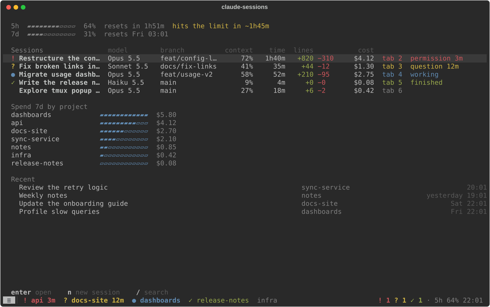

# Usage

## Opening it

```sh
cst
```

`cst` opens the tmux session of your Claude Code sessions, or attaches to it if it is already
running. It runs on a tmux server of its own, so it never mixes with your other tmux sessions.
Tab 1 is the panel; every other tab is one Claude Code session.

```sh
cst --ghostty
```

does the same in a new Ghostty window that leaves the Alt keys to tmux (see the
[installation guide](install.md#ghostty)).

Start a session with Alt+c, or with n in the panel. Any `claude` running in a tab of this tmux
server is tracked, however it was started: its tab takes the name of the project folder and the
colour of its status. A tab you renamed yourself keeps your name.

## Statuses

| Status | Tab | Meaning |
|---|---|---|
| Permission | red `!` | Claude needs your approval to run something |
| Question | amber `?` | Claude asked you something, or has a plan for you to approve |
| Finished | green `✓` | The turn ended (or failed) and you have not looked at it yet |
| Working | blue `●`, blinking | Running tools, or background tasks still going |
| Idle | grey, no mark | Finished and already seen, or interrupted with Esc |

- **Colours:** the whole tab takes its status's colour; the current tab is a block in that
  colour.
- **Waiting time:** a tab in permission or question for over a minute shows for how long, as
  `3m` or `1h`.
- **Dots on the right:** one red or amber dot for each tab waiting for you, before the clock.
- **Finished turns:** a finished session becomes idle as soon as you look at it, by switching
  to its tab or by already being on it when the turn ends.
- **Esc:** pressing Esc in Claude Code fires no hook, so an interrupted session turns idle a
  few seconds later, when the panel notices it.
- **Several panes:** teammates of an agent team open in panes of the same tab; the tab shows
  the most urgent status among them, and `+N` for the extra panes.

## Keys

Every shortcut is Alt plus one key, from any tab:

| Keys | Does |
|---|---|
| Alt+1 | The panel (tab 1) |
| Alt+2 … Alt+9 | The tab with that number |
| Alt+0 | Back to the tab you were on before |
| Alt+← / Alt+→ | Previous / next tab (also Alt+, / Alt+.) |
| Alt+n | The next session that needs you: permission and question first, then finished ones, round and round |
| Alt+c | New session: pick a recent project folder, or type a path |
| Alt+g | Commit history of the tab's project, over the tab (q closes it) |
| Alt+r | Renames the tab; an empty name gives back the project folder |

A click on a tab also switches to it. Ctrl+b stays with Claude Code; rare tmux commands use
Ctrl+Space as the tmux prefix.

### Alt+c: new session



The picker lists the folders Claude Code has run in, most recent first. Type to filter them,
then press Enter to open a new tab running `claude` in the folder. A path that is not in the
list works too, `~` included. Esc cancels.

### Alt+g: commit history



Alt+g opens `tig` over the tab, in the folder of the tab's session. Press q to close it. In a
folder that is not a git repository, it says so instead.

## The panel



The panel refreshes every second. Ctrl+C does not close it, and if it ever stops, tmux starts
it again. From top to bottom:

### Header

`Claude sessions`, then how many open sessions are in each status, in the status's colour.

### Usage

- **5h limit and 7d limit:** how much of your account's 5-hour and 7-day usage limits you
  have used, as a bar that turns amber at 70% and red at 85%, and when the limit resets
  (`resets in 1h52m`, or the day and time when that is more than a day away). A bar is hidden
  until Claude Code has reported it, and once its reset time has passed.
- **today:** what your sessions cost today, and in brackets how much of it is in the
  sessions still open. A session counts once its cost changes today: one left open since
  yesterday without a new prompt is not counted.
- **waited for you today:** how long sessions spent today waiting for your permission or your
  answer.

### Open

One row per open session in this tmux server, in tab order:

| Column | Shows |
|---|---|
| Mark | `!` permission, `?` question, `●` working (blinking with its tab), `✓` finished, none when idle |
| Title | The session's title: the one you set with `/rename`, else the one Claude Code gave it, else your first prompt, else `New session` |
| cost | What the session has cost so far, in dollars |
| time | How long the session has been running |
| model | The model in use |
| lines | Lines added (green) and removed (red) |
| Right | `tab N`, then the status and how long it has waited for you, in the status's colour |

A session that has not had its first status line update yet shows empty cells. When the panel
is narrow, the title gets shorter first, then the columns drop from the right: lines, model,
time, cost.

### Today

One bar per open session, from the first event of the day among them to now, on a shared hour
axis. Each cell is coloured by the session's status at that time; when a cell spans several
statuses, it shows the most urgent one, so a short permission wait stays visible. The legend
below names the colours.

### Recent

Your latest sessions from Claude Code's history that are not open in a tab, up to 50: title,
project folder, and when you last used it (the time today, `yesterday`, the weekday, or the
date). A session still running outside this tmux server says `open elsewhere`.

### Keys

| Keys | Does |
|---|---|
| ↑ ↓ or j k | Move the selection, across the open and the recent sessions |
| A click | Selects a row; only Enter opens it |
| Enter | Goes to an open session's tab, or resumes a recent one in a new tab, in its folder |
| n | New session, as Alt+c |
| / | Search: type words, and only the sessions whose title or folder holds them all stay; Enter keeps the search, Esc clears it |
| Esc | Clears the search |

## Where the numbers come from

Claude Code gives `cs` its information in two ways. Its hooks tell `cs hook` about every event
of a session, which sets the status. Its status line hands `cs statusline` the session's cost,
time, model, lines and the account's usage limits. The journal is the day's history that `cs`
keeps from both, so the totals survive sessions closing and the panel restarting.

| Number | Source |
|---|---|
| Status, tab colour and mark | Hooks |
| Waiting time on a tab and in the Open rows | Hooks: when the session entered its status |
| Header counts | Hooks, over the open sessions in this tmux server |
| cost, time, model, lines | Status line, at its latest update |
| 5h and 7d limits | Status line, from whichever session updated last |
| today, and the part in open sessions | Journal: the sum of the latest cost each session reported today, closed sessions included |
| waited for you today | Journal: the time sessions spent in permission or question today |
| Today's bars | Journal: each open session's status changes today |
| Titles and Recent | Claude Code's own files: its prompt history and the session transcripts |

## Limitations

- **Linux only.** Session liveness comes from `/proc`, and `cst --ghostty` uses a Ghostty
  option that exists only on Linux.
- **Sessions crossing midnight.** Cost today takes each session's total so far, so a session
  that crosses midnight counts on both days: today's figure includes what it spent before
  midnight.
- **Waits crossing midnight.** Waiting time counts from each session's first event of the day:
  a wait that began yesterday is not counted.
- **Usage needs the status line.** The usage columns and limit bars fill in only once Claude
  Code updates the status line, and limits only for Claude subscribers (see
  [troubleshooting](install.md#troubleshooting)).
- **One tmux server.** Only sessions in tabs of the `cst` server count as open; others show in
  Recent as `open elsewhere`.
